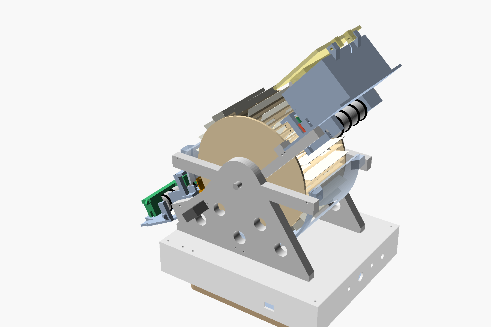
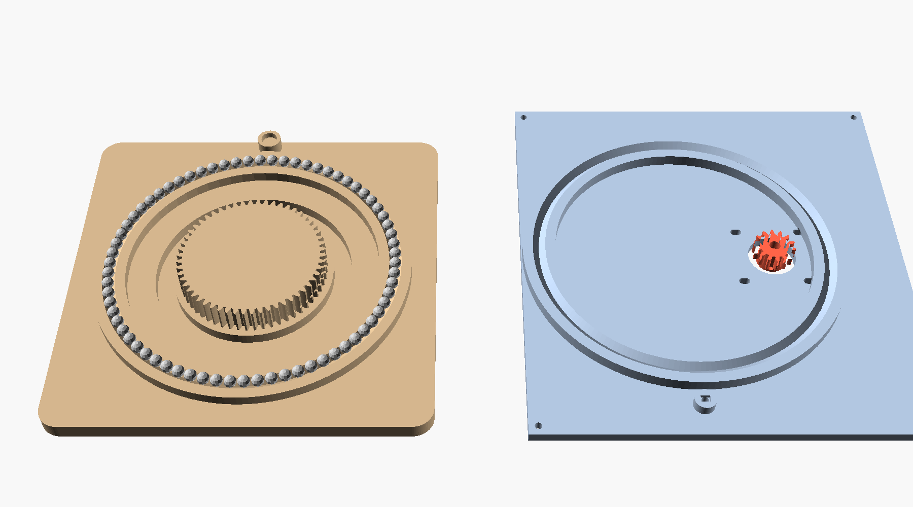
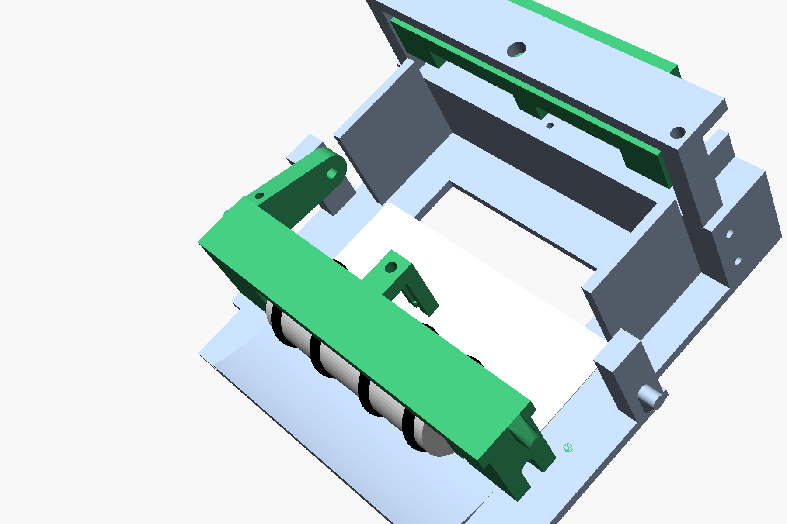

# 11. Dealer: shuffle, then deal round the table

**Status: designed, unbuilt.** The CAD passes the printability and collision checks, and the firmware
passes the syntax check against the mock (DEALER on and off) and the host tests. Nothing has been
printed or run. Every time, speed and distance below is an estimate **[EST]**.

The dealer build turns the shuffler into a dealing machine. Set the number of players on a phone and
press the button. The machine shuffles, then throws each player's hole cards to their seat one at a
time, round the table. The rest of the deck is then either handed to the dealer in the chute, or kept
in the wheel and delivered as burn + flop, burn + turn and burn + river, one press each.

## 11.1 How it works

1. **Load.** Put the deck in the hopper and press the button (or "Shuffle & deal" on the phone).
2. **Shuffle.** This is the unchanged LOAD phase: each card goes into a uniformly random empty slot
   of the 54-slot wheel (`02-mathematics.md`).
3. **Turn.** The whole machine stands on a turntable. It turns until the chute points at the first
   player, the seat clockwise of the dealer button.
4. **Throw.** The exit nip pulls the next card out of the wheel, in slot order, exactly as in the
   plain shuffle. The card slides down the chute into a spinning top roller, which pinches it against
   the floor and throws it off a short ramp. The ramp bends it from 28° down to 5° down, so the card
   lands flat and slides to the player.
5. **Repeat.** The machine turns to the next player, round the table, once per hole card.
6. **The rest of the deck**, in one of two modes:
   * **Rest to the dealer.** The machine turns to face the dealer, stops the roller and empties the
     wheel into the chute. The stopped roller is the end wall, so the stub piles up where the old
     chute's output pile was.
   * **Board on request (default).** The rest stays inside the wheel, where nobody can see or touch
     it. Each press delivers burn + 3 (flop), then burn + 1 (turn), then burn + 1 (river) into the
     chute. The burn is the bottom card of each small pile. One more press delivers the remainder.
7. **Next hand.** The button moves one player clockwise.

### Fairness

The plain shuffle's output order is a uniformly random permutation (`02-mathematics.md` §2.2).
Dealing assigns positions in that order to players by a fixed rule: round robin from the seat after
the button, then the burn and board positions. Applying a fixed rule to a uniformly random
permutation gives uniformly random hands, boards and burns, whatever the number of players, the
button's position or the mode. Nothing else changes: the RNG, the seed and the insertion
verification are as before.

The machine never knows which card is which. Nothing it stores or shows, including the phone page,
can tell anyone what a player holds or what comes next. The page never sees the RNG key or the slot
plan, and those are only printed on the USB serial console.

## 11.2 Design choices

| Question | Chosen | Rejected, and why |
|---|---|---|
| How to aim at seats | **Turn the whole machine** on a turntable | A separate rotating thrower fed from the exit. The card would have to pass along the turntable's axis, which means dropping it flat into the turret: unreliable. |
| Power to the turning part | **None needed.** The battery and every board already ride on the machine, so it can turn forever in either direction | A slip ring, or cables limited to ±180° |
| Bearing | **Printed ball race**: two 90° V-grooves at r 70 with 70 × 6 mm balls | A commercial lazy-susan plate. Its centre-hole size varies between makers, and the gear has to fit inside that hole |
| Drive | **NEMA 17 (34 mm), printed spur gears 56/14 = 4:1**, driven by a second TMC2208 | Direct drive (too little torque margin), a belt (needs a tensioner), a geared 28BYJ-48 (too slow, and needs 4 pins) |
| Turntable home | **Hall switch** under the cover and a magnet in a post on the foot | An optical flag. It needs height in the 14 mm gap and a slot that clears the ball race |
| Launcher | **Spinning top roller** on a pivoting arm, plus a fixed ramp. Stopped, it is the chute's end wall | (a) A second nip at the chute end: its housing hangs below the floor, so the chute could no longer print floor-down. (b) Throwing with a fast exit nip: the card would leave 80 mm above the table at 28° down, hit the table hard and bounce, and the stub would have nowhere to stop |
| Controller pins | **Keep the ESP32 DevKitC.** Only one new pin (GPIO22, from the optional deck sensor); everything else shares | Moving to an ESP32-S3 would give plenty of pins but needs a full pin remap of every document. It stays the upgrade path if more I/O is ever needed |
| User interface | **Phone page** over the ESP32's own Wi-Fi access point. Nothing to buy | An OLED and encoder: needs pins and parts, and seat calibration would be clumsy |

## 11.3 Turntable

Left: the static foot. Right: the underside of the turning cover with the pinion.

| | |
|---|---|
| Foot (static) | 180 × 180 × 8 mm, four 12 mm rubber pads. It carries the lower race, the static 56-tooth gear (module 1.25) and the magnet post |
| Turning side | `tt_cover_front` replaces `base_cover_front`: 5 mm instead of 2.5, with the upper race ring underneath. It rests on the four corner bosses of `base_front`, so the machine's weight goes walls → bosses → cover → balls → foot |
| Race | V-grooves 3 deep at r 70, 70 × 6 mm balls (steel, or 0.2 g airsoft BBs). The races sit 2.5 mm apart. The axis is at x = 22, y = 0 in the machine frame, near the centre of mass |
| Drive | 34 mm NEMA 17 standing on the cover, with a 14-tooth pinion through it meshing with the static gear: 4:1. The motor's screw slots set the backlash. 12 800 µsteps per turn, 0.03° each |
| Index | A3144 hall switch (open collector) in a boss under the cover at r 86, 2 mm over an 8 × 3 mm magnet in the post |
| Height | The machine sits 24 mm higher than before. The table is at z = −24 in the machine frame |
| Sweep | Turning parts reach r 206 from the axis (the launcher). **Keep a Ø 420 mm circle clear of chips and drinks.** The lowest turning part (the base) is 24 mm above the table, the launcher 40 mm |
| Motion | 180°/s peak, 460°/s² (8 rad/s²). One 45° seat move ≈ 0.6 s **[EST]** |
| Torque | Turning inertia ≈ 0.04 kg·m² **[EST]** (2.6 kg over a 330 × 230 footprint) → 0.32 N·m at 8 rad/s² → 8 N·cm at the motor through 4:1, plus ≈ 1 N·cm friction. A 34 mm NEMA 17 at ≈ 1 A gives ≈ 20 N·cm at 120 rpm: about 2× margin |
| Stability | The ball circle (r 70) is the support polygon, and the centre of mass is within ≈ 15 mm of the axis **[EST]**. The race has no retention: leaning on the chute end with more than ≈ 7 N tips the machine off the balls, and it settles back. That is accepted |

## 11.4 Launcher

| | |
|---|---|
| Throw roller | The feed-roller part (Ø 27 over four 20 × 3.5 O-rings) on an N20 6 V 3000 rpm motor, axis at chute r 185. Its contact point (r 182.2) is where the old end wall was |
| Arm (`throw_arm`) | Pivots on two M3 screws 32 mm upstream. Its weight plus a rubber band over the pegs presses the roller on the floor. Two M3 × 30 stop screws hold the O-rings 0.1 mm off the bare floor, so the roller spins free until a card arrives. Lift the arm by hand to clear a jam |
| Ramp | R 60, from 28.3° down to 5° down, 24 mm long. The lip is 47 mm above the table and 200 mm from the turntable axis |
| Throw speed | 2500 rpm × π × 27 mm ≈ 3.5 m/s free-running at 5 V. The default power 170/255 gives ≈ 2.3 m/s **[EST]** |
| Distance | ≈ 70 ms in flight, landing ≈ 15 cm out at ≈ 20°, then sliding v² / 2µg on cloth (µ ≈ 0.3 **[EST]**): 0.7 m at 2 m/s. Reach from the axis ≈ 0.2 + 0.15 + slide. Each seat gets its own power, set on the phone |
| Beam L | 940 nm LED under the floor at r 169, phototransistor in a boss on the arm looking down. It confirms each card was thrown (blocks, then clears) and that the chute is empty before a deal |
| Stub | With the roller stopped, cards pile against it, up to the 27 mm roller face |

The card is pinched by a single roller on a smooth floor. The roller grips it (O-ring, µ ≈ 0.9) and
the floor drags it (PETG, µ ≈ 0.3), so the net push is about 0.6 × the pressing force. At 0.3 N
that accelerates a 1.8 g card at about 100 m/s², reaching throw speed in about 30 mm. The pivot is
upstream, so the card's reaction pulls the roller down onto it (self-energising).

## 11.5 Electronics: one new pin

| Signal | Wiring |
|---|---|
| Turntable STEP | **GPIO22**, the only new pin. The optional deck sensor is dropped |
| Turntable DIR, EN | In parallel with the wheel driver's (GPIO26, GPIO27). Only one motor moves at a time, and the firmware sets DIR before each move |
| Turntable index | The hall switch's open-collector output joins the wheel index on **GPIO19**. LOW means the wheel's tab *or* the magnet. The firmware moves the other axis off its index before homing either one |
| Throw roller | DRV8833 #2's spare B channel. **BIN1/BIN2 are wired to GPIO4/5**, the entry-nip signals, so it spins whenever the entry nip does. That is harmless: no card is near the entry nip while dealing, and the launcher is empty while loading (checked before every load) |
| Beam L | Its phototransistor is **in series with beam B's** on GPIO34 (either blocked reads blocked). Its LED joins the IR_EN string with 150 Ω. B is only used while loading and L only while dealing. Both must be clear before a load |
| Second TMC2208 | VM from VBAT with 100 µF, VIO 3V3, MS1 = MS2 = 3V3 (1/16), Vref ≈ 1.0 V for a 1.0–1.3 A motor. The main board grows to 90 × 70 mm to fit it |

If `tt jog 10` turns the machine anticlockwise seen from above, set `TT_DIR_INVERT 1`. If the
roller throws backwards, swap the throw motor's leads.

**Power [EST].** Wi-Fi in access-point mode adds ≈ 0.45 W continuously. The turntable adds
≈ 0.02 Wh per hand. A 4-hour evening of 40 hands is ≈ 7.8 Wh, so ≈ 2½ evenings per charge,
against 3–4 without the dealer. Unplug the charger before dealing, or its cable winds round the
machine.

**Wi-Fi and the RNG.** While the radio runs, the RF subsystem makes `esp_random()` true-random, and
Espressif says the ADC entropy source (`bootloader_random_enable`) must not be used alongside it.
The dealer build therefore seeds from `esp_random()` plus the avalanche board and the jitter pool.
The pipeline after that is unchanged and bit-exact with `rng_reference.py`.

## 11.6 Firmware

`DEALER 1` in `config.h` builds the dealer, and `0` builds the plain shuffler (both syntax-checked).
New modules: `dealer.*` (turntable, throws, hand stages, settings in NVS) and `webui.*` (access
point and phone page).

| Step | Time [EST] |
|---|---|
| Home the turntable (first hand after power-up) | ≤ 3 s |
| Shuffle (LOAD phase, 52 cards) | ≈ 26 s |
| Each hole card: turn ≈ 0.6 s, index the wheel 0.07 s, spin up 0.15 s, eject and throw ≈ 0.3 s | ≈ 1.1 s |
| 6 players × 2 cards / 9 players × 2 | ≈ 14 s / ≈ 21 s |
| Flop / turn / river (board mode) | ≈ 2 s each |
| Rest of the deck to the chute (stub mode) | ≈ 10 s |

Shuffle and deal for six Hold'em players is therefore ≈ 40 s from the press to the last hole card.

**Checks.** Before every load, beams B and L must be clear (nothing in the chute or at the gate).
For every throw, beam X must block and clear, then beam L must block and clear within 0.9 + 0.4 s.
Before each street the chute must be empty, so piles never mix. A card that is too slow on beam X
is reported as a possible double. Any failure stops the deal and is reported as a misdeal, and
"Finish hand" empties the wheel. The phone's Stop button and a long button press stop between
cards.

**Physical button.** A press when idle shuffles and deals. During a board-mode hand, each press
deals the next street, then the rest. Hold for 3 s to unload everything into the chute.

## 11.7 Phone page

Join the Wi-Fi network **Shuffler-XXXX** (password `shuffle52` until you change it on the page) and
open **http://192.168.4.1**. The page has:

* **Actions:** Shuffle & deal, Deal the flop / turn / river, Finish hand, Shuffle only, Stop.
* **Game:** seats round the table (2–10), cards each (1–7; 2 Hold'em, 4 Omaha, 5 PLO5), what happens
  after the hole cards, the dealer button, and whether the button moves each hand.
* **Seats:** for each seat, whether a player is there, its angle and its throw power, plus Aim,
  Here (store the current angle) and Test (feed one card and throw it there). "Spread" spaces the
  seats evenly over an arc.
* **Turntable:** jog ±1/5/15°, Home, Aim at dealer, Dealer is here.
* **Wi-Fi password.**

Settings are saved on the machine. While it is busy the page shows progress, and only Stop works.
The serial console has the same commands (`deal`, `street`, `finish`, `tt …`, `seat k aim|here|test`,
`dealer here`, `dealcfg`).

## 11.8 Build additions

Printed parts (`cad/print-settings.md` §dealer): `tt_foot`, `tt_cover_front` (instead of
`base_cover_front`), `tt_pinion`, `chute_dealer` (instead of `chute`) and `throw_arm`, plus one more
`roller_feed`. `base_front` and `base_rear` now have corner bosses for the cover screws, which in the
plain design had nothing to bite into. Collision checks: `cad/dealer_check.sh` (all clear).

1. **Turntable.** Grease the grooves lightly (PTFE or silicone). Glue the magnet into the foot's
   post, marked face up. Glue the hall switch into its pocket, branded face down, and lead its wires
   up through the cover. Press the pinion onto the 34 mm NEMA 17 with its teeth 1 mm under the
   cover's underside, and tighten the grub on the flat. Screw the motor to the cover. Fill the
   foot's groove with balls, lower the cover onto them, and slide the motor along its slots until
   the gears turn with a trace of backlash.
2. **Cover to base.** Fit the battery, boards and noise board in `base_front` first, then screw the
   cover to the four corner bosses (M3 × 10).
3. **Launcher.** Fit the throw roller's stub axle into the arm's U-slot and close it with the cross
   screw, then push the N20 into its pocket and hot-glue it. Screw the arm to the posts (M3 × 10
   pivots). Set the stop screws so a 0.1 mm feeler slides under the O-rings. Hook a rubber band
   over the arm's and post's pegs on each side.
4. **Wiring:** as §11.5.
5. **Calibrate.** `cal beams` (machine empty). `tt home`. Check `tt jog 10` turns clockwise seen
   from above. Point the foot's magnet side at the dealer, or use "Dealer is here". Then for each
   seat: Aim → jog → Here → Test, and adjust its power until the card stops in front of the player.

## 11.9 Risks and how to retire them

Prototype the launcher first: print `chute_dealer` and `throw_arm`, clamp them at 28°, and throw
100 cards by hand-feeding the floor. Then the turntable, then the whole machine.

| Risk | Test | Fallback |
|---|---|---|
| Cards flip or curl when thrown | 100 throws at 3 powers; count flips | Lower the lip angle (`throw_ang` 2°), larger `ramp_R`, more arm pressure |
| Throw distance varies too much | Spread of landing points at fixed power on your cloth | Higher roller pressure; per-seat power; a faster N20 |
| The stub stops short of the roller or rides over it | 34-card stub, 20 times | Steeper chute floor is fixed; raise the roller pressure; a felt strip on the floor |
| Printed race rumbles or wears | 2000 turns with a full machine | Steel balls instead of BBs, grease, or a 6 in. lazy-susan plate (re-enter its hole size) |
| Turntable stalls or loses steps | Count steps over 100 hands: re-home at the start of every hand and log the offset | Lower `TT_ACC_DPS2`, raise Vref |
| Shared index confuses homing | Power-up with the wheel's tab and the magnet both on their sensors | The firmware moves each axis off before homing the other; otherwise give the hall switch its own pin on an S3 |
| Wi-Fi noise in the beams | `beams` with the phone page open and loading | Beams are LED-on minus LED-off; raise BEAM_SAMPLES |

## 11.10 Parts to add (BOM delta)

| # | Part | Qty | Est. |
|---|---|---|---|
| D1 | NEMA 17, 34 mm body (17HS3401 class, 1.0–1.3 A) | 1 | $9 |
| D2 | TMC2208 stepstick | 1 | $5 |
| D3 | 6 mm balls: steel bearing balls, or 0.2 g airsoft BBs | 70 | $4 |
| D4 | A3144 hall switch (open collector) | 1 | $0.50 |
| D5 | Neodymium magnet 8 × 3 mm | 1 | $0.50 |
| D6 | N20 gearmotor 6 V **3000 rpm**, 3 mm D shaft (throw roller) | 1 | $4 |
| D7 | IR LED 940 nm + phototransistor, 3 mm (beam L) | 1 + 1 | $0.75 |
| D8 | O-rings 20 × 3.5 (throw roller) | 4 | from the assortment |
| D9 | Stick-on rubber pads 12 mm | 4 | $1 |
| D10 | M3 × 30 (stop screws) ×2, M3 × 5 grub ×1; others from the assortment | — | $0.50 |
| D11 | Perfboard 90 × 70 mm instead of 70 × 50, 100 µF 25 V | 1 | $1.20 |
| D12 | Rubber bands | 2 | scrap |
| | **Dealer add-on** | | **≈ $26** |

Filament: ≈ 0.4 kg more PETG **[EST]**. The foot can be PLA, since it is static.
